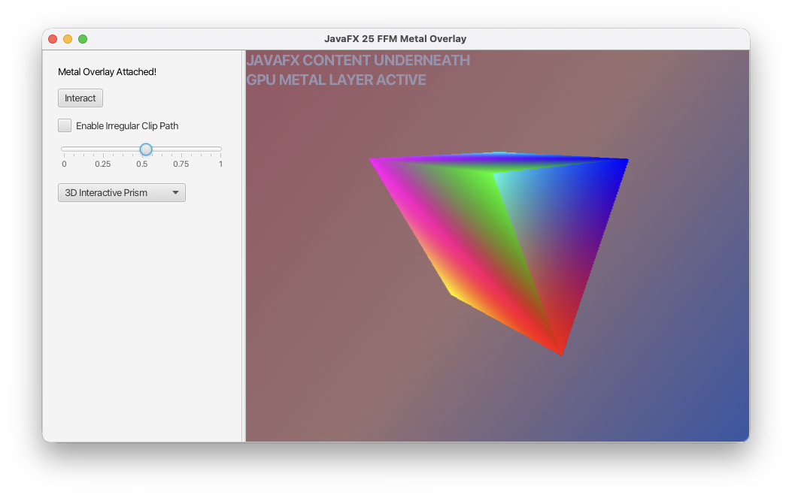

= JavaFX + Metal Proof of concept Demo

Welcome to this fun demo to integrate an embedded native surface to render high performance graphic on the GPU using MacOS's Metal API. This will help bridge the divide between retained and immediate mode rendering under one roof. 

Demo shown on Youtube: https://www.youtube.com/watch?v=JwTDGDEmGts

This project is about learning and having fun with JavaFX and native code bindings. If you like this project please give me a shout out to let me know that this might be useful.

- X (formally known as Twitter): https://x.com/carldea
- LinkedIn: https://www.linkedin.com/in/carldea
- Youtube: https://www.youtube.com/@carldea

== Why?
Imagine building retro MP3 player (WinAmp knock off) with irregular shaped window and 2D/3D visualization using advanced shader code (linear math on the GPU) All the while still having sleek JavaFX stylized UI controls for the user to configure the player.

By unlocking native capabilities on a device the possibilities are endless. 



== Brief history

*Thread vs Thread*

For those who have been in the Java world for a bit AWT/Swing has it's own threading context (EDT) and so does JavaFX's application thread. Both can be difficult to manage let alone the underlying graphic pipeline for MacOS's NSWindow thread rules. 

In prior attempts over the years I tried with JavaFX's `SwingNode` to access native code using JNI, which really became a nightmare. Now with project Panama this made things a whole lot easier.

There are other subtle things to keep an eye on that can get you in trouble is receiving mouse events from both JavaFX and NSWindow (hint: turn off mouse events on the native side). 

== What's here?
This repository contains a small macOS (arm64) prototype that demonstrates rendering a Metal layer
on top of a JavaFX window using the Java Foreign Function & Memory API to call a native Objective-C
renderer. The demo includes a native Metal renderer (renderer.m) built into `librenderer.dylib` and
a JavaFX front-end (`NativeMetalApp.java`) that binds to the native API.

- `renderer.m` - Mac/Cocoa Objective-C dynamically link library.
- `build_lib.sh` - shell script to compile library.
- `NativeMetalApp.java` - JavaFX demo app with Panama FFI that talks to native library (`librenderer.dylib`)


== Platform

- Primary target: macOS on Apple Silicon (arm64)

== Requirements

- macOS (Apple Silicon recommended)
- Xcode Command Line Tools (clang/clang++ / make):

```bash
xcode-select --install
```

- JDK 25 or later (required for the `java.lang.foreign` API and Linker usage). Shortened `main()` method and `IO.println`
- JavaFX 26 or later (Now using Metal for MacOS)
- jbang (optional — `NativeMetalApp.java` includes a jbang shebang and dependency directives)
- Homebrew (optional) for installing `jdk` / `jbang` / other tools

== Build the native library

1. Make sure the Xcode command line tools are installed.
2. From the project root run:

```bash
chmod +x build_lib.sh
./build_lib.sh
```

This will compile `renderer.m` into `librenderer.dylib` using Metal and Cocoa frameworks.

== Run the Java demo

There are two simple ways to run the Java application.

.Using jbang (recommended if you have `jbang` installed)

```bash
# Ensure jbang is installed (see https://jbang.dev)
jbang NativeMetalApp.java
```

.Run via the script shebang (if jbang is installed and the file is executable)

```bash
chmod +x NativeMetalApp.java
./NativeMetalApp.java
```

If you prefer to run without jbang, compile and run with `javac`/`java` making sure to include
the JavaFX modules and native-access runtime options shown in the source file. The jbang
directives in the file handle those dependencies automatically when using jbang.

== What the demo does

- Creates a borderless transparent child `NSWindow` above the JavaFX window and attaches a
	`CAMetalLayer` to it.
- Uses Metal to render either a 2D triangle or a 3D prism, with an adjustable alpha/opacity.
- JavaFX controls (slider, combo box, mouse drag) call native functions via the Panama
	Foreign Function & Memory API to change alpha, render mode, rotation, and bounds.

== Troubleshooting

- "Could not resolve native Glass handle": ensure your JavaFX/Glass runtime is compatible and
	that you run the app on the native macOS platform (not in a headless environment).
- If `librenderer.dylib` fails to load, verify the file exists and has correct permissions:

```bash
ls -l librenderer.dylib
```

- Ensure you are using a JDK that supports the `java.lang.foreign` API (JDK 25+). If using
	macOS security/privacy prompts, allow the app to use the screen/window as needed.

== Future work: Windows & Linux ports

- Windows: implement a native renderer backing with Direct3D or DirectX 12 and a layered
	transparent window. The native-to-Java bindings can remain similar (C ABI) and be exposed as
	`librenderer.dll` with exported functions.
- Linux: consider Vulkan or EGL with an X11/Wayland overlay. On Wayland the approach for
	transparent overlays differs; prefer an in-process approach or use platform-specific windowing
	APIs.
- Cross-platform plan: create a small C ABI shim with the same exported functions (`init_metal_renderer`,
	`update_renderer_bounds`, `render_frame`, `set_renderer_alpha`, `set_render_mode`, `update_rotation`)
	and provide per-platform implementations (Metal / Direct3D / Vulkan). Use the Panama Linker to
	load the correct library per-OS at runtime.

== Notes

- This repo is a prototype or proof of concept. The native code intentionally performs UI/window operations on the
	main thread via `dispatch_sync` / `execute_on_main_thread` helpers.
- For production use consider error handling hardening, lifecycle management, and secure
	permission handling for native access.

== License & Attribution

Copyright 2026 Carl Dea

Licensed under the Apache License, Version 2.0 (the "License");
you may not use this file except in compliance with the License.
You may obtain a copy of the License at

    http://apache.org

Unless required by applicable law or agreed to in writing, software
distributed under the License is distributed on an "AS IS" BASIS,
WITHOUT WARRANTIES OR CONDITIONS OF ANY KIND, either express or implied.
See the License for the specific language governing permissions and limitations under the License.

